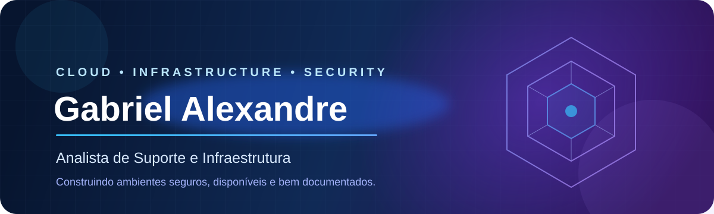

 

# Gabriel Alexandre

### Analista de Suporte & Infraestrutura | Cloud Engineer em formação

**Transformando experiência em infraestrutura corporativa em soluções de nuvem seguras, automatizadas e observáveis.**

**[Sobre mim](#-sobre-mim) · [Experiência](#-experiência-profissional) · [Projetos](#-projetos-em-destaque) · [Competências](#-competências-técnicas) · [Certificações](#-certificações-e-desenvolvimento) · [Contato](#-vamos-nos-conectar)**

---

## 👋 Sobre mim

Sou **Gabriel Alexandre**, profissional de Tecnologia da Informação com atuação em **suporte técnico corporativo, infraestrutura, redes, identidade e administração de ambientes Microsoft**.

Minha experiência envolve a sustentação de sistemas críticos, diagnóstico de incidentes, monitoramento, resolução de problemas de conectividade e suporte a usuários e serviços empresariais. No dia a dia, trabalho com tecnologias como **Active Directory, Microsoft Entra ID, Microsoft 365, Intune, Zabbix e Grafana**.

Estou construindo minha transição para **Cloud Engineering**, com foco em **AWS, Linux, Terraform, Python, automação, CI/CD e observabilidade**. Para consolidar esse aprendizado, desenvolvo projetos práticos, versionados e documentados, com testes e controles de segurança.

> 🎯 **Objetivo profissional:** oportunidades como **Cloud Engineer Jr., Cloud Operations ou Cloud Support**, aplicando minha base de infraestrutura à engenharia de ambientes em nuvem.

## 💼 Experiência profissional

| Experiência | Atuação e competências |
|---|---|
| **Toyota Tsusho Group** · Analista de Suporte Jr. · **mai/2026 – atual** | Suporte e infraestrutura corporativa; atendimento e análise de incidentes; Active Directory, Entra ID, Microsoft 365, Intune; monitoramento com Zabbix/Grafana; investigação de instabilidades em sistemas empresariais. |
| **Tecnocomp** · Suporte / Infraestrutura · **out/2025 – abr/2026** | Suporte a ambientes corporativos, Microsoft 365, VPN, monitoramento, gestão de chamados e troubleshooting de estações, aplicações e serviços. |

### 🔍 Experiências técnicas que levo para Cloud

- **Troubleshooting estruturado:** correlação de logs, eventos Windows, processos, conectividade e métricas para investigar incidentes.
- **Redes e acesso seguro:** laboratórios com **802.1X, EAP-TLS, RADIUS/NPS**, certificados digitais e autenticação corporativa.
- **Identidade e dispositivos:** administração e suporte envolvendo **AD, Entra ID, Intune e Microsoft 365**.
- **Monitoramento e automação:** scripts **PowerShell e Python**, dashboards e acompanhamento de disponibilidade de serviços.
- **Documentação operacional:** registro de evidências, procedimentos, checklists e comunicação técnica de incidentes.

---

## 🚀 Projetos em destaque

### ☁️ [SecureCorp AWS — Secure Cloud Infrastructure & DevSecOps](https://github.com/Gabriel-F4l/SecureCorp-AWS.)

**Projeto autoral de arquitetura AWS e Infrastructure as Code — versão 1.0 concluída.**

Desenvolvi um laboratório para modelar uma infraestrutura AWS segura e validar suas configurações antes de qualquer implantação.

| Pilar | O que foi desenvolvido |
|---|---|
| **Arquitetura** | Amazon VPC Multi-AZ, sub-redes públicas e privadas isoladas e S3 Gateway Endpoint |
| **IaC** | **Terraform** e **AWS CDK com Python** |
| **Segurança** | IAM, Security Groups restritivos, S3 privado e políticas de acesso |
| **Observabilidade** | VPC Flow Logs, CloudWatch Logs e AWS KMS definidos em Terraform |
| **Automação** | GitHub Actions, Pytest e Checkov |

**Evidências da validação local:** `13 testes Pytest aprovados` · `Terraform validate: sucesso` · `Checkov: 40 aprovados, 0 falhas, 1 exceção documentada`.

> **Escopo transparente:** laboratório de Infrastructure as Code, **não implantado em uma conta AWS**. As configurações CDK e Terraform são implementações separadas.

### 🧪 Outros laboratórios

| Projeto | Foco |
|---|---|
| [**Azure Enterprise Lab**](https://github.com/Gabriel-F4l/Azure-Enterprise-Lab) | Estudos e práticas com infraestrutura e serviços Azure |
| [**SuperTech Network Lab**](https://github.com/Gabriel-F4l/packet-tracer-lab) | Topologias de rede, conectividade e fundamentos de redes |

---

## 🛠️ Competências técnicas

| Área | Tecnologias / práticas |
|---|---|
| **Cloud e IaC** | AWS (VPC, S3, IAM, KMS, CloudWatch), AWS CDK, CloudFormation, Terraform |
| **Automação e desenvolvimento** | Python, PowerShell, Git, GitHub Actions, Pytest |
| **Infraestrutura e sistemas** | Windows Server, Active Directory, Microsoft 365, Microsoft Entra ID, Intune |
| **Redes e identidade** | TCP/IP, DNS, DHCP, VPN, VLAN, 802.1X, EAP-TLS, RADIUS/NPS |
| **Segurança** | Privilégio mínimo, IAM, certificados, controles de acesso e Checkov |
| **Monitoramento e operações** | Zabbix, Grafana, logs de aplicação e sistema, análise de incidentes |
| **Em aprofundamento** | Linux, Docker, CI/CD, Cloud Operations e observabilidade AWS |

## 🏅 Certificações e desenvolvimento

**Certificações e cursos concluídos:**
- Microsoft Certified: **Azure Fundamentals (AZ-900)**
- **ITIL 4 Foundation**
- Cisco — **Introduction to Cybersecurity**
- Cisco — **Endpoint Security**
- **Scrumstudy**

**Em preparação:** AWS Certified Solutions Architect – Associate (**SAA-C03**). *Ainda não obtida.*

**Formação:** trajetória de estudos em Tecnologia da Informação, com continuidade acadêmica planejada.

---

## 🤝 Vamos nos conectar

Estou aberto a trocar experiências sobre **Cloud Engineering, infraestrutura, automação e boas práticas de segurança**, além de conhecer oportunidades alinhadas à minha evolução profissional.

---

**Gabriel Alexandre · Cloud Engineering · Infrastructure as Code · Automation · Security**

*Construindo conhecimento técnico com projetos práticos, documentação e melhoria contínua.*

